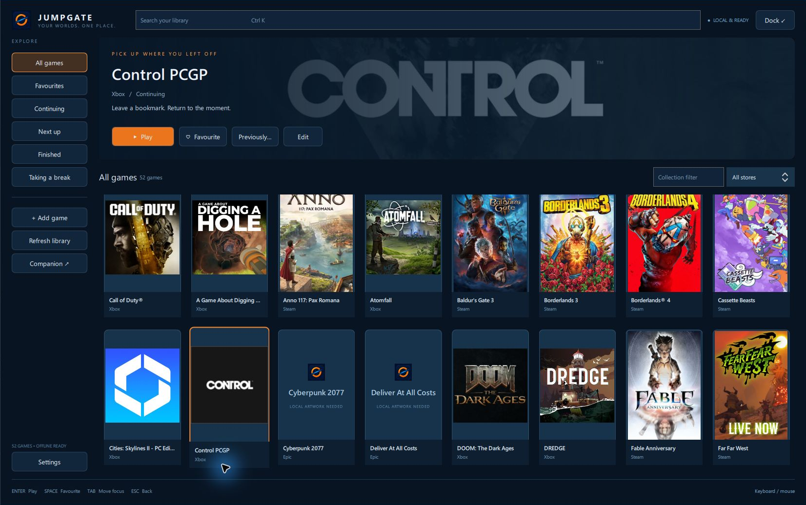
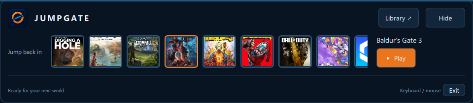
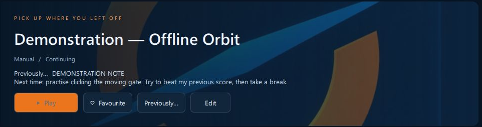
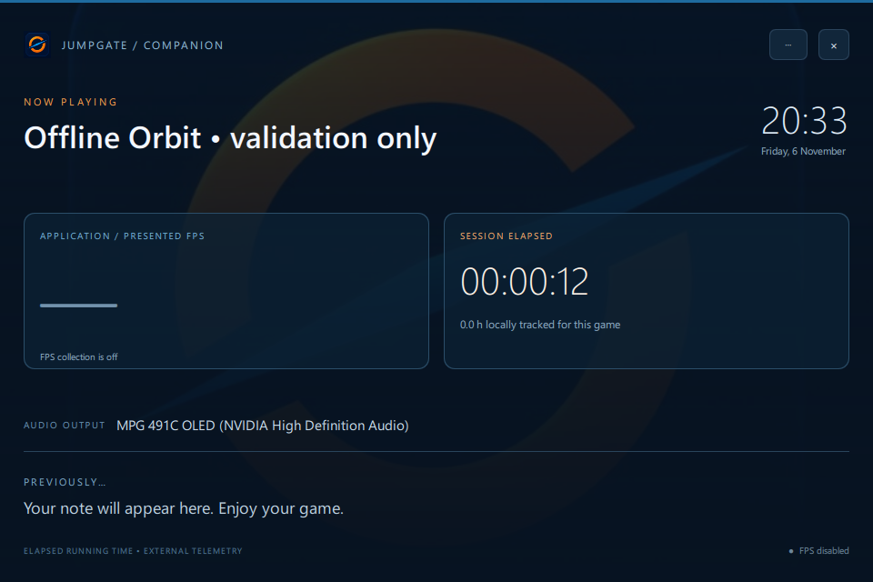

# Jumpgate

Jumpgate brings my installed games together in a Windows launcher designed around how I use my gaming PC. I can choose something to play, organise what I want to return to and leave myself a note for next time.

*Games from several stores share one library, with artwork and categories for deciding what to play next.*

## Why I built it

I wanted to customise more of the experience around playing games, in a way that suited my hardware and style. Jumpgate gives me my own place to choose a game, with audio choices and a companion display alongside it.

## Choosing a game

The Library is the full browsing view. I can search, filter by store or collection and mark games as Continuing, Next up, Finished or Taking a break. Favourites give me a quick route back to the games I reach for most.

Jumpgate finds installed Steam, Epic and Xbox/Microsoft Store games, and I can add games manually. It launches them through their usual store clients, which still handle accounts and access. If I have more than one installation of a game, I can group them and choose which one to launch.

Covers come from artwork already on the PC or images I choose. Games without artwork show a title tile, ready for me to add an image later. There is no online artwork lookup in the current implementation.

## Jumping back in from the Dock

The Dock is the smaller launcher view: a row of games and a Play button when I do not need the whole Library.

*The Dock keeps game selection close by; Library opens the larger view.*

I can browse with the keyboard, search with a shortcut and switch between Dock and Library. Controller navigation is also available while the launcher is active.

I can adjust the interface scale, reduce motion and let the launcher remember the positions of its windows. Closing the window keeps Jumpgate available in the tray, so I can bring it back when I need it.

## Remembering where I left off

Previously… is where I leave my own bookmarks: a note, an optional reference image and a status. It gives me somewhere to record what I want to remember before I put a game aside.

*A demonstration bookmark puts the next thing I want to try directly on the game’s library card.*

Session history records how long the identified game is running. Menus and idle time can count, and some games need their actual program identified before tracking works. Interrupted sessions can be marked uncertain.

## A companion on another screen

Companion is a separate display for game artwork, the clock, session time, audio output and my previous note or reference. I can use it on a secondary screen and have it open for selected games without taking focus away from them.

*An Offline Orbit demonstration session shows artwork, elapsed session time and the selected audio output. FPS is switched off.*

Audio profiles let me choose an output before launching a game and optionally restore the previous one afterwards. Manual audio changes and overlapping games are taken into account.

There is also an optional FPS display. It has been verified with a test application and a Call of Duty menu, but availability varies by game and account permissions. It is off by default.

## From picking a game to coming back later

I open the Dock or Library, search or choose Continuing, then press Play. A configured audio profile can select my output, and Companion can appear on the other screen. When I finish, I can leave a Previously… note to make the next visit easier.

## Current status

Jumpgate is a working personal launcher. This page showcases it; there is no public executable download here.

Game detection, controller behaviour and display handling still need broader hands-on testing. Individual launch chains and protected game processes can limit tracking or FPS collection; anti-cheat compatibility is not guaranteed.

## Technology

Python, PySide6/Qt Quick and SQLite, with Windows process tracking and audio output profiles. Optional PresentMon collection supplies application/presented FPS. A read-only interface can share library and session information with other tools.
